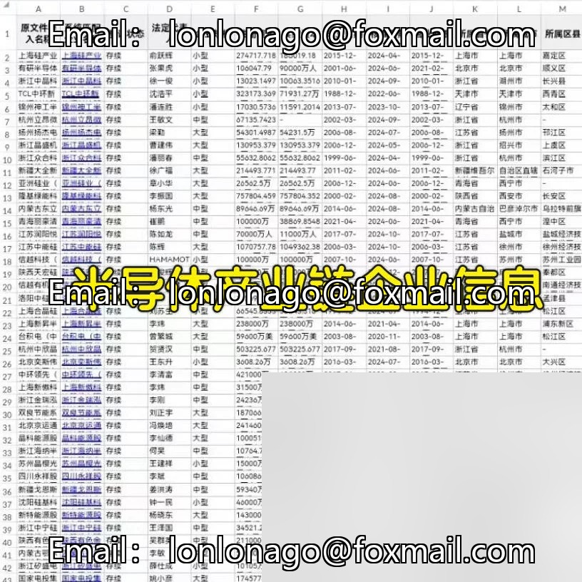
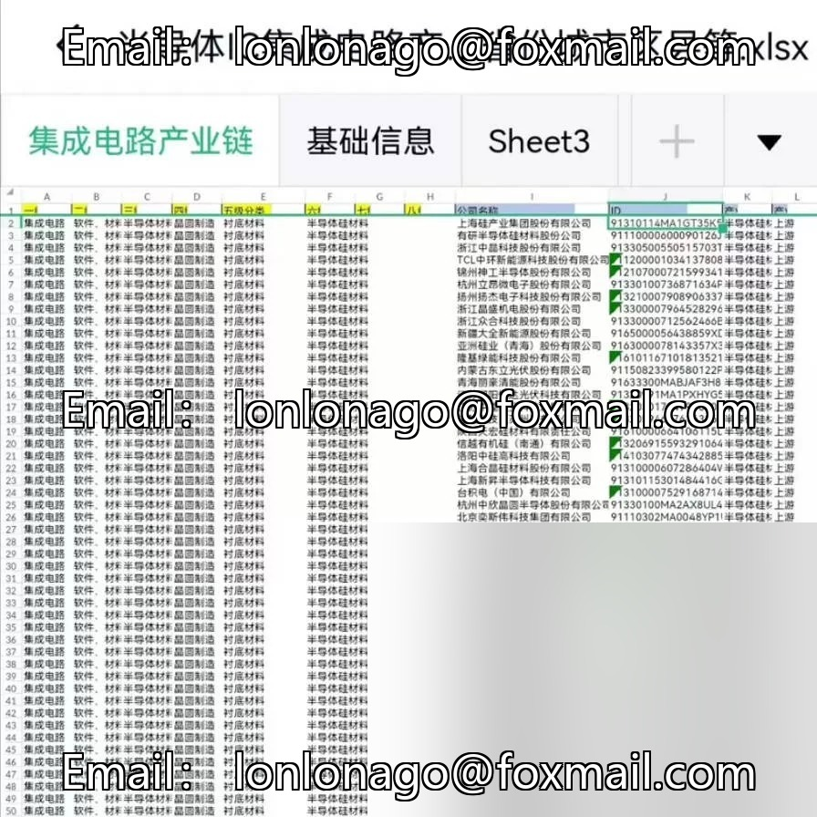
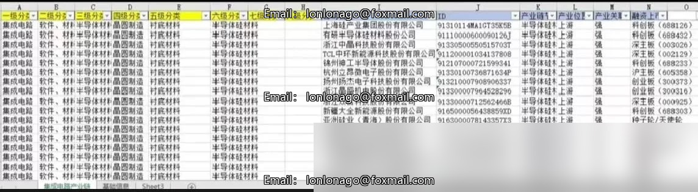
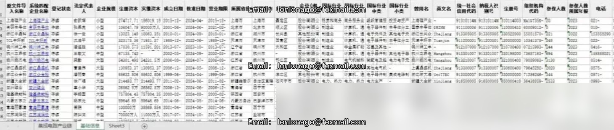

# Semiconductor IC integrated circuit industry chain national information and data of enterprises at top, middle and bottom

## Body

Semiconductor IC integrated circuit industry chain national information and data of enterprises at top, middle and bottom
Node correlation, enrolled headcount, contact information, legal representative, industry affiliation, province/city/district/county and other areas
With more than 20,000 base information tables and industry chain relationship table data records respectively

This data includes all enterprise information for all upstream, middle, and downstream enterprises from 1949 to 2024. Note: emerging industries currently collect only upstream and middle enterprises.

Included Excel tabs:
First tab: The industry chain nodes, industry position, and industry correlation of the enterprise; Level 1 classification, Level 2 classification, ... Level 8 classification; Company name ID; Industry chain nodes, industry position, and industry correlation; Financing and listing.

Enterprise basic information, including:
Original file import name Registration status Legal representative Enterprise scale Registered capital Actual paid capital Establishment date Approval date Business term Province/Region City/District/County Enterprise(Organizational) type Standard national industry category Standard national industry major category Standard national industry intermediate category Standard national industry minor category Taxpayer identification number Registration number Previous names English name Unified social credit code Organization code Participants count Participant count annual report Provider Initial year And more email addresses Annual report year And so on

web-based shipment, can be directly photographed and shipped.

The data covers semiconductor IC and integrated circuit industry chain enterprise information across China's upstream, midstream and downstream, including node relationships, insured personnel, contact information and legal representatives, with two data tables and Excel tabs.

<!-- AI_ENRICHED -->

## Images

## Payment

Here is a pay link on Stripe ( https://buy.stripe.com/3cs8yP7sY87d0vu9AB ). Please contact me lonlonago@foxmail.com after funding $89, and I will send you a complete data files , thank you!

